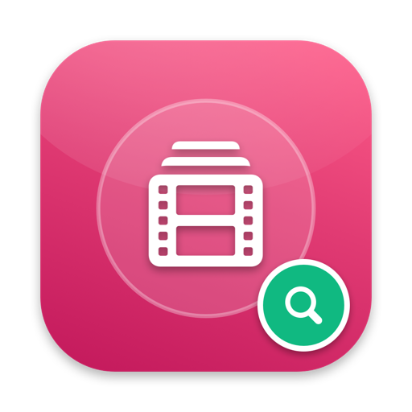
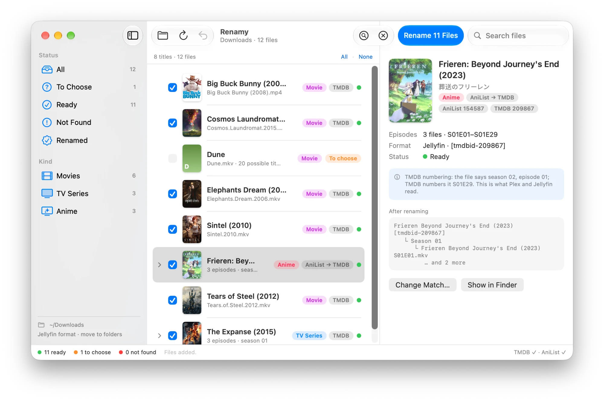
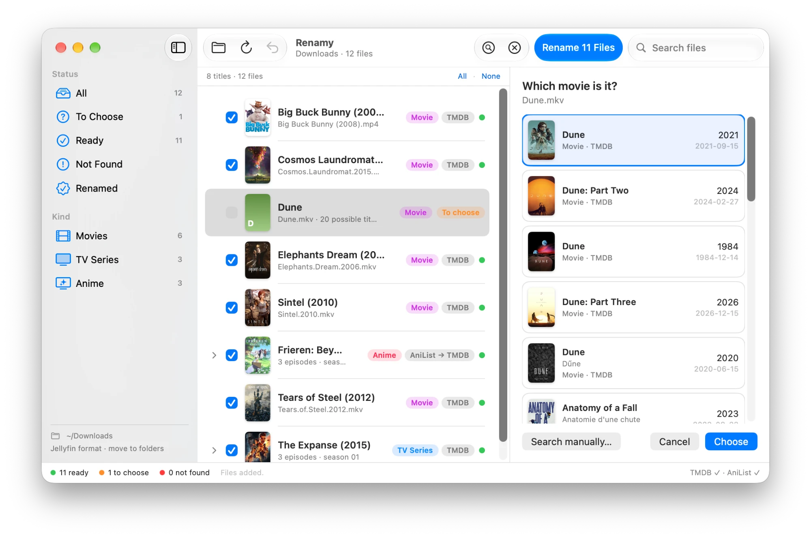
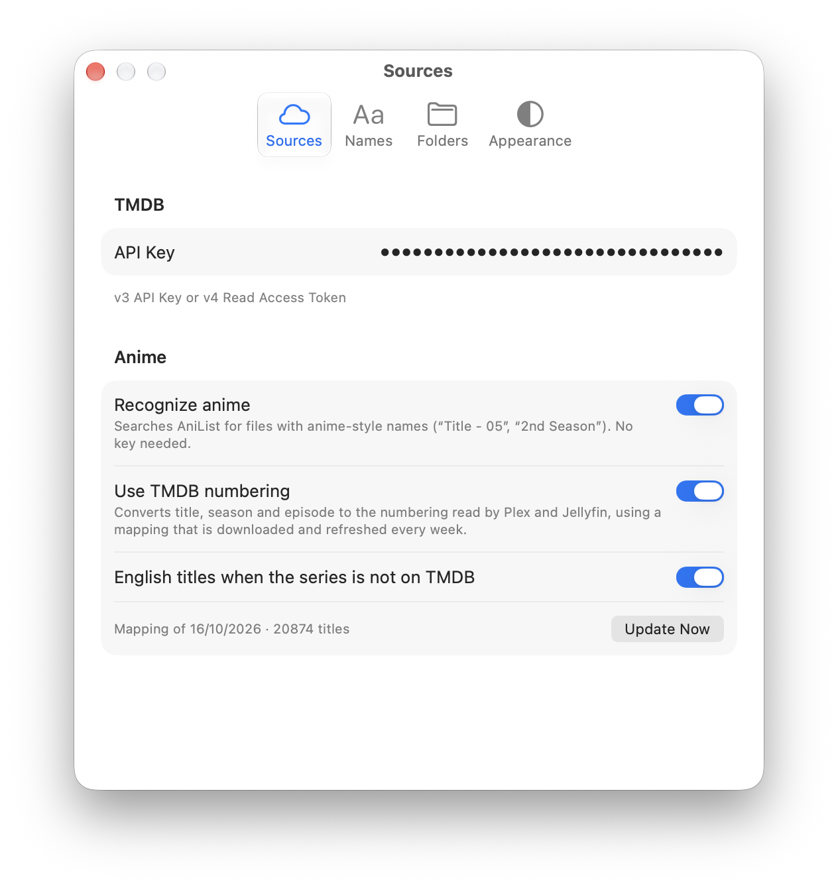

# Renamy 🎬


**Renamy** is a native macOS application developed in SwiftUI designed to help users manage, organize, and rename their personal video library files efficiently using official metadata.

<p align="center"></p>



> Renamy was previously called **Regia**. Settings are not migrated: re-enter your TMDB API Key after updating.

## ✨ Features
- **Library at a Glance:** A three-column window with filters by status and kind, files grouped by series and movie with posters, and a details panel showing IDs, numbering and the folders that will be created.
- **Smart Anchor Logic:** Intelligently identifies the movie or show title by detecting the year or season, cleaning up inconsistent filenames automatically.
- **Metadata Integration:** Connects to TMDB to retrieve official titles, release years and posters for accurate cataloging.
- **TV Series Support:** Recognizes `SxxExx`, `1x02`, absolute numbering (`Title - 05`), a season in the title (`S2 - 03`, `2nd Season - 04`) and episode numbers inside `Season 1` folders.
- **Anime Support:** Anime-style names are matched on AniList (no key needed) and converted to the TMDB title, ID and season/episode numbering read by Plex and Jellyfin, using a community ID mapping refreshed every week. Can be turned off in Settings.
- **One Choice per Series:** When a title is ambiguous, all episodes of the series are resolved with a single choice, and **Also apply to** offers the other files with the same title (only those in the same folder start checked).
- **Structured Organization:** Optional feature to move files into a standardized folder hierarchy, compatible with popular media servers.
- **Plex, Jellyfin & Emby Support:** Supports standardized naming conventions including identifiers (`{tmdb-id}` for Plex, `[tmdbid-id]` for Jellyfin).
- **Manual Search by ID:** Fix any match by title, TMDB ID (`#12345`, `tv:12345`, `movie:12345`) or a themoviedb.org link.
- **Drag & Drop:** Drop files or folders directly onto the window.
- **Disambiguation:** Choose the right match in the details panel, with posters, years and sources; Enter to choose, Esc to cancel.
- **Undo Capability:** Safety feature to revert the last rename or move operation instantly, including the folders it created.
- **Appearance:** System, Light and Dark themes.
- **Multi-language:** Native support for Italian 🇮🇹 and English 🇬🇧.



<p align="center"></p>

## 🚀 Requirements
- macOS 14.6 (Sonoma) or later.
- A personal [TMDB API Key](https://developer.themoviedb.org/docs/getting-started) (Free) is required to fetch metadata. Both the v3 API Key and the v4 Read Access Token are supported.
- Apple Silicon Mac.

---

## 🍺 Installation via Homebrew (Recommended)

```bash
brew install --cask gionnio/tap/renamy
```

Renamy is part of [Gionnio's Homebrew tap](https://github.com/Gionnio/homebrew-tap), together with my other apps.

> Installed it from the old `gionnio/renamy` tap? Switch to the new one:
> ```bash
> brew uninstall --cask renamy && brew untap gionnio/renamy
> brew install --cask gionnio/tap/renamy
> ```

### 🔄 Updating

```bash
brew upgrade --cask renamy
```

---

## 📥 Manual Installation (Pre-built App)

1. Go to the **[Releases](../../releases)** section of this page.
2. Download the latest `.zip` file (e.g., `Renamy_v3.0.0.zip`).
3. Unzip the file and move `Renamy.app` to your **Applications** folder.

### ⚠️ Important: How to open the app

Since this is an open-source project and not signed with a paid Apple Developer ID, macOS might block the first launch with a security warning ("App cannot be opened because the developer cannot be verified").

**To open it:**

1. Open `Renamy` once and close the warning.
2. Go to **System Settings → Privacy & Security**, scroll down and click **Open Anyway** next to the Renamy message.
3. Confirm with **Open**.

*Right-click → Open no longer works on macOS 15 (Sequoia) and later. You only need to do this once.*

## 🛠 Build from Source

1. Clone the repository or download the source code.
2. Open `Renamy.xcodeproj` with Xcode.
3. Run the app (Cmd+R).
4. Open **Settings** and enter your TMDB API Key.

## 🚧 Roadmap & TODO

* [ ] **System Notifications:** Native macOS notifications when long processing tasks are finished.
* [ ] **Custom Renaming Format:** A custom pattern editor (e.g., `{title} - [{year}]`) beyond the built-in presets.
* [x] **Homebrew Support:** Install and update via `brew install --cask gionnio/tap/renamy`.
* [x] **Anime Support:** AniList matching with TMDB numbering.
* [x] **New Interface:** Three-column window with posters and a details panel.

## Privacy & Security

This application runs locally on your device. Your TMDB API Key stays in the app preferences on your Mac. Only the titles to look up are sent to the official TMDB API and, for anime-style names, to the AniList API; the anime ID mapping is downloaded from its public GitHub repository ([Fribb/anime-lists](https://github.com/Fribb/anime-lists)) and kept in the app cache. Posters are loaded from the TMDB and AniList image servers. File names and folders never leave your Mac.

## 🤖 AI Acknowledgment

This application was developed with the assistance of Artificial Intelligence for code generation, logic optimization, and problem-solving.

---

Created with AI, ❤️ and SwiftUI.
